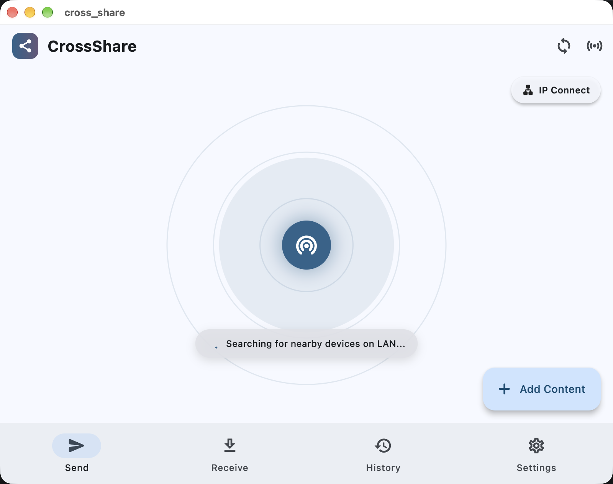

# CrossShare

A fast, cross-platform local network file sharing application built with Flutter. CrossShare allows devices on the same Wi-Fi or LAN to discover each other and transfer files or text snippets instantly, serving as an open ecosystem alternative to AirDrop.


## Features

- 📡 **Radar Discovery**: Automatically sweep the local subnet via UDP and HTTP to discover nearby active devices on an interactive radar canvas.
- 🔐 **Encrypted Device Pairing**: Exchange a 6-digit PIN to securely pair devices. Trusted devices save AES-encrypted auth tokens locally, enabling seamless background transfers without manual approval popups.
- 🚀 **Multi-Device Batch Transfers**: Use "Send To..." to pick specific target devices, or "Send to All" to instantly broadcast files to every active device on the network simultaneously.
- 🌐 **Browser Web Portal**: Generate a QR code and local IP link to allow any device with a web browser (Smart TVs, legacy PCs, iPhones) to download files without installing the app.

---

## Screenshots

<details open>
<summary>Click to view screenshots</summary>

### Radar & Discovery


*(More screenshots coming soon)*

</details>

---

## How to Run & Build

### Prerequisites
- [Flutter SDK](https://docs.flutter.dev/get-started/install) (`^3.12.2` or newer).

### Running locally
1. Clone the repository and fetch dependencies:
   ```sh
   flutter pub get
   ```
2. Run on a connected physical device or desktop simulator:
   ```sh
   flutter run
   ```
   *(To specify a target device, use `flutter run -d <device_id>`)*

### Running Tests
To run unit and integration tests (validating the transfer engine and encrypted pairing storage):
```sh
flutter test
```

---

## Architecture Overview

CrossShare is built using modern Flutter and Dart patterns:

- **State Management**: Fully reactive state powered by `flutter_riverpod`.
- **Networking (`dart:io`)**:
  - `DiscoveryService`: Uses UDP multicasting and HTTP subnet sweeps to locate peers.
  - `HttpServerService` & `TransferEngine`: Handle peer-to-peer file streams via a custom local HTTP server using `shelf` and `shelf_router`.
- **Security (`crypto`)**:
  - `EncryptedPairingStorage`: Device IDs and trusted auth tokens are encrypted on-disk using AES/SHA-256 derived keys ensuring your trusted devices remain secure.
- **Project Structure**:
  - `lib/ui/`: Contains the presentation layer (Screens, Widgets, Dialogs).
  - `lib/services/`: Core logic (Networking, Web Portal HTTP Server, Encrypted Storage).
  - `lib/providers/`: Riverpod state containers coordinating UI and Services.
  - `lib/models/`: Strongly-typed data definitions.

*Note: File transfers use plain LAN HTTP. Device pairing utilizes token-based authorization for auto-accepting transfers, but traffic interception protection relies on your local Wi-Fi network's WPA2/WPA3 encryption.*
